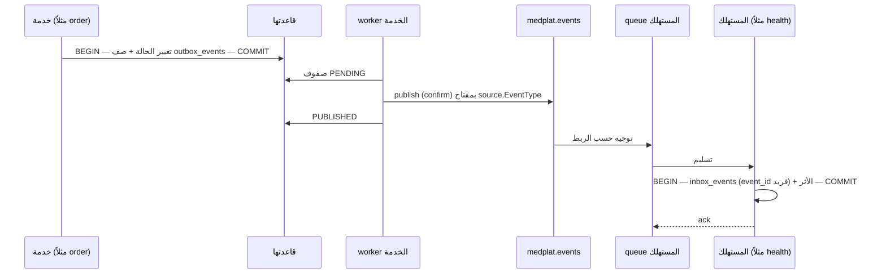
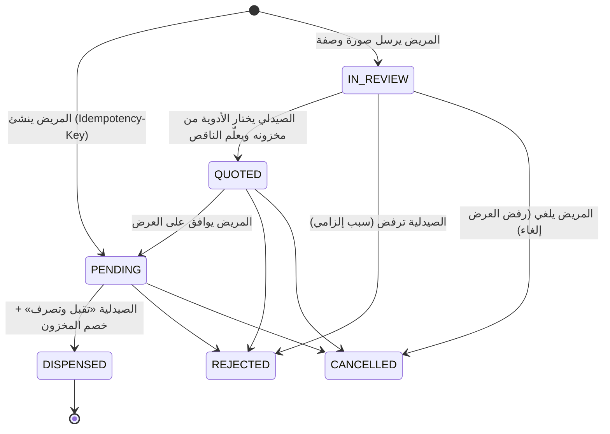
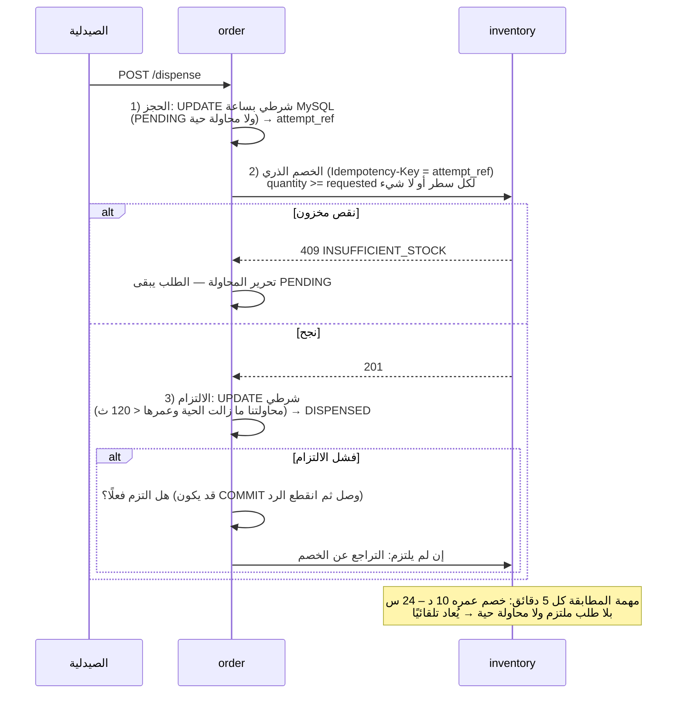

# المعمارية

هذه الوثيقة تشرح **كيف** بُني النظام ولماذا. القرارات بتفاصيلها وبدائلها في
`DECISION_LOG.md`، والجداول في `db/medplat_schema.sql`، والمسارات في رأس `routes.py` لكل خدمة.

## 1. الصورة الكلية

```mermaid
flowchart LR
    UI["الواجهة<br/>HTML + CSS + JS (RTL)"] -->|"/api/v1/*<br/>Bearer JWT"| GW["scripts/web.py<br/>الصفحات + توجيه بالمسار"]
    GW --> AUTH[auth :5001]
    GW --> PAT[patient :5002]
    GW --> PH[pharmacy :5003]
    GW --> MED[medication :5004]
    GW --> INV[inventory :5005]
    GW --> ORD[order :5006]
    GW --> HLT[health :5007]
    GW --> AI[ai :5008]
    GW --> NOT[notification :5009]

    ORD -. "internal HTTP" .-> PAT & PH & MED & INV
    AUTH -. "اسم المريض" .-> PAT
    PH -. "حساب صاحب الصيدلية" .-> AUTH
    INV -. .-> MED
    NOT -. "اسم الدواء" .-> MED
    INV -. "مطابقة" .-> ORD
    PH -. "توفر" .-> INV
    AI -. "مؤشرات" .-> HLT

    subgraph MQ["RabbitMQ — exchange medplat.events (topic)"]
    end
    AUTH & PAT & PH & MED & INV & ORD & HLT & AI -- "outbox" --> MQ
    MQ -- "inbox" --> HLT & AI & NOT
```

- **9 خدمات، 9 قواعد** (سجل التدقيق حُذف بقرار صاحب المشروع، DECISION_LOG «د»). كل خدمة تملك قاعدتها وحدها (`svc_<name>` بصلاحيات
  DML فقط)، ولا مفتاح أجنبي يعبر قاعدتين (BR-008). المراجع بين الخدمات
  UUID عامة (`CHAR(36)`)، والأرقام الداخلية لا تخرج من الخدمة أبدًا.
- **عمليتان لكل خدمة من ملف واحد:** `main.py api` يخدم الـ API، و`main.py worker` ينشر الـ outbox
  ويستهلك الأحداث ويشغّل المهام الدورية. انهيار أحدهما لا يوقف الآخر.
- **الحزمة المشتركة `medplat`** تحمل ما يجب أن يكون واحدًا في كل الخدمات:
  التحقق من JWT، تحقق المدخلات، شكل الخطأ، request id، outbox/inbox،
  RabbitMQ، ضبط الإعدادات، والصياغة العربية. لا منطق أعمال فيها.

## 2. الاتصال المتزامن (HTTP داخلي)

يُستعمل فقط حين يحتاج المستدعي الجواب **الآن** ليقرر:

| من | إلى | لماذا |
|---|---|---|
| order | patient | هل للمريض ملف؟ (اسمه لطابور الصيدلية) |
| order | pharmacy | هل الصيدلية معتمدة؟ ومن مالكها؟ |
| order | medication | لقطة اسم الدواء وشكله وحجم علبته |
| order | inventory | السعر الحالي (quote)، ثم الخصم والتراجع عند الصرف |
| inventory | medication | الدواء موجود ونشط؟ البحث بالاسم |
| inventory | order | المطابقة: هل التزم طلبٌ بهذا الخصم؟ (دفعات حتى 500) |
| pharmacy | inventory | توفر دواء (أو بدائله معًا) في الصيدليات القريبة، وما تعرضه صيدلية |
| pharmacy | medication | بدائل دواء بنفس التركيبة، أو بدائل ما يطابق نص بحث المريض [قرار المستخدم] |
| medication | patient، pharmacy | اسم صاحب طلب للإدارة لحظة إرساله [قرار المستخدم] |
| ai | health | مؤشرات الالتزام لملخص عند الطلب (مع توزيعها على وقت اليوم والدواء) |
| ai | النموذج اللغوي المحلي [خارجي] | صياغة نص الملخص (`AI_LLM_URL`، Ollama افتراضيًا)؛ اختياري: بدونه القالب الثابت |
| notification | medication | اسم الدواء لنص الإشعار (أفضل جهد: بدونه يُرسل الإشعار بلا الاسم) |
| كل خدمة صيدلية | pharmacy | تحديد الـ tenant من الـ token (مخزَّن 15 ثانية) |

المسارات `/internal/v1/...` محمية برأس `X-Internal-Token` (مقارنة
`hmac.compare_digest`) ولا تمر عبر البوابة. كل استدعاء يحمل `X-Request-ID`
الأصلي، فيُتتبع الطلب الواحد عبر الخدمات. انقطاع الخدمة المستدعاة يرجع
`503 SERVICE_UNAVAILABLE` لا 500.

## 3. الأحداث (RabbitMQ)

### 3.1 المسار



- **Outbox (BR-022):** الحدث يُكتب في نفس transaction التغيير. انقطاع
  RabbitMQ لا يُفقد حدثًا؛ الصفوف تبقى PENDING بلا استهلاك محاولات وتُنشر عند
  عودته، والمستهلكون يعيدون الاتصال وحدهم (مثبت بإيقاف RabbitMQ فعليًا
  أثناء العمل). الـ API نفسها لا تحتاج الـ broker لتعمل، ولذلك
  لا يدخل في `/ready` الخاص بها.
- **Inbox (BR-023):** المستهلك يسجل `event_id` بقيد فريد في نفس transaction
  الأثر. التسليم المكرر يصطدم بالقيد فيُتجاهل. وحيث يمكن لنسختين مختلفتي
  المعرّف أن تحملا نفس الحقيقة، قيد فريد على مفتاح العمل نفسه (مثلاً
  `order_item_ref` في سجل الحصول) يغلق الثغرة.
- **معرّفات حتمية:** أحداث المهام الدورية (`DoseDue`، `AdherencePeriodClosed`)
  معرّفها uuid5 من الجرعة/الأسبوع، فتشغيل المهمة مرتين لا يرسل تذكيرين.
- **رسائل ميتة:** لكل queue رفيقة `.dlq`؛ رسالة تفشل معالجتها ترفض إليها بدل
  أن تدور بلا نهاية.

### 3.2 من يستمع لماذا

| queue | الأحداث | الأثر |
|---|---|---|
| `health.events` | `order.OrderDispensed`، `order.OrderItemDosePlanned` | الدواء يدخل سجل المريض بكميته بالوحدات (UC-HLT-01)، ومعه جدول مقترح إن كتب الصيدلي طريقة الاستعمال؛ أو جدول مقترح جديد لطريقة كُتبت بعد الصرف [قرار المستخدم] |
| `notification.events` | `auth.UserRegistered`، `auth.UserSuspended`، `auth.UserReactivated`، `order.*`، `pharmacy.PharmacyStatusChanged`، `inventory.InventoryLowStock`، `health.DoseDue`، `health.MedicationRunningLow`، `health.DoseScheduleProposed`، `ai.AIInsightCreated`، `medication.MedicationRequestAnswered` | إشعار عربي للمستفيد |
| `ai.events` | `health.AdherencePeriodClosed` | ملخص التزام أسبوعي |

الأحداث المنشورة: auth (`UserRegistered`, `UserLoggedIn`, `UserLoggedOut`,
`RefreshTokenReuseDetected`, `UserSuspended`, `UserReactivated`)، patient (`PatientProfileCreated/Updated`)، pharmacy
(`PharmacyRegistered`, `PharmacyProfileUpdated`, `PharmacyStatusChanged`,
`PharmacyDocumentUploaded/Deleted`, `PharmacistAdded/Updated`)، medication (`MedicationCreated/Updated`,
`MedicationRequestCreated`, `MedicationRequestAnswered`)،
inventory (`InventoryItemCreated/Updated`, `StockAdjusted`, `StockDeducted`,
`StockDeductionReversed`, `InventoryLowStock`)، order (حدث لكل حالة من
`OrderCreated` إلى `OrderDispensed`، و[قرار المستخدم] `OrderQuoted` و `OrderQuoteApproved` للوصفة،
و `OrderItemDosePlanned` و `MessageSent`)، health (`PatientMedicationAdded`, `PatientMedicationReplenished`,
`DosageScheduleCreated/StatusChanged`, `DoseScheduleProposed`, `DoseRecorded`, `DoseDue`,
`MedicationRunningLow`, `AdherencePeriodClosed`)، ai (`AIInsightCreated`).

## 4. الطلب وبروتوكول الصرف (سجل القرارات «ب»)

### 4.1 آلة الحالات (§11.1 مبسّطة، قرار «د»)



القبول هو الصرف: لا `APPROVED` ولا `PREPARING` ولا `READY`. الخصم يبقى لحظة `DISPENSED` (BR-012).
طلب الوصفة [قرار المستخدم، «د»] (`kind = PRESCRIPTION`) يبدأ بلا أصناف؛ قيد CHECK يمنع `IN_REVIEW` و `QUOTED`
لغيره. العرض لا يخصم ولا يحجز، والكمية تُفحص مرة عند العرض ومرة عند الصرف.

كل انتقال على صف الطلب مقفولًا (`SELECT … FOR UPDATE`) مع تحقق من حالته الحالية
(الصرف وحده بـ UPDATE شرطي، انظر 4.2)، ويكتب
صفًا في `order_status_history` (لا UPDATE ولا DELETE عليه لحساب الخدمة) وحدثًا
في الـ outbox، في transaction واحدة. قيد CHECK في القاعدة يمنع `DISPENSED` بلا
مرجع خصم حتى لو كُتب SQL مباشرة.

### 4.2 الصرف عبر قاعدتين

المواصفة (§11.2) ترسم الخصم والصرف في transaction واحدة، وهذا مستحيل لأن
المخزون والطلب في قاعدتين. البديل ثلاث مراحل بتعويض:



الضمانات المثبتة باختبارات فعلية عبر HTTP:

- صرفان متزامنان لنفس الطلب → واحد ينجح، والمخزون خُصم مرة واحدة.
- inventory متوقفة أثناء الصرف → 503، الطلب يبقى PENDING، ولا خصم.
- خصم يتيم (كأن order انهارت بعد الخصم) → المطابقة تعيده، ولا تمس خصم طلب
  مصروف.

وفي المخزون: 10 خصومات متزامنة على 5 علب → 5 تنجح، والكمية 0 لا سالبة.

## 5. الأمن

| الطبقة | التنفيذ |
|---|---|
| كلمات المرور | Argon2id؛ لا تُخزَّن ولا تُسجَّل نصًا |
| الجلسة | access JWT بـ RS256 لمدة 15 دقيقة (iss/aud/exp/nbf/jti)؛ كل خدمة تتحقق منه محليًا بالمفتاح العام. refresh token معتم يُخزَّن SHA-256 فقط، يدوَّر مع كل استعمال، وإعادة استعمال قديم تلغي العائلة كلها |
| حدود المحاولات | الدخول والتسجيل وتجديد الجلسة: حد لكل IP ولكل معرّف في نوافذ زمنية، في MySQL (`auth_rate_limits`) بعبارة ذرية واحدة؛ المفتاح HMAC بـ `RATE_LIMIT_PEPPER` فلا يُخزَّن بريد ولا IP كنص |
| منع التعداد | الدخول بكلمة مرور خاطئة وبمعرّف غير موجود يرد الخطأ نفسه بالكلفة نفسها (§10.5) |
| الأدوار | `@require_auth(role)` على كل مسار؛ مسح آلي طرق كل مسار في كل خدمة بلا token وبدور خاطئ |
| الـ tenant | من الـ token عبر pharmacy-service، لا من جسم الطلب؛ حقل `pharmacy_id` من العميل مرفوض صراحة |
| المدخلات | عقد صارم: حقل مجهول → 422، كل الأخطاء معًا، نصوص NFC بلا surrogates، أرقام منتهية فقط، بريد ASCII، حد حجم 64KB (5MB لرفع الوثائق مع فحص المحتوى لا الامتداد) |
| القاعدة | لا root وقت التشغيل؛ `svc_*` بصلاحيات DML على جداولها فقط، والسجلات التاريخية الأربعة (حالة الصيدلية، حركات المخزون، حالة الطلب، سجل حصول المريض) SELECT/INSERT فقط |
| الخصوصية | موقع المريض لا يُخزَّن ولا يظهر في سجل الوصول؛ الأدمن يرى من المريض بيانات حسابه فقط؛ الأخطاء لا تكشف قيم SQL. خدمة الطريق الخارجية ترى إحداثيات المريض والصيدلية من المتصفح مباشرة (§6) |
| الاستجابات | `Cache-Control: no-store` لكل ما يخص المصادقة وصور الوصفات؛ `nosniff` للتنزيلات |
| الوصفة والرسائل [قرار المستخدم] | صورة الوصفة على القرص باسم UUID ونوعها من محتواها، يفتحها صاحبها والصيدلية المرسلة إليها فقط (لا الأدمن). المحادثة لطرفيها فقط، والرسائل إضافة فقط (`svc_order` بلا UPDATE ولا DELETE عليها)، وحد 20 رسالة في الدقيقة |
| عنوان العميل | حدود كل IP تقرأ `X-Forwarded-For` من `TRUSTED_PROXY_HOPS` وسيطًا فقط (البوابة) |
| إيقاف الحساب | الأدمن يوقف حساب مريض بسبب مكتوب: الحالة `SUSPENDED` وإلغاء كل جلساته في transaction واحدة، والدخول بعدها 403 `ACCOUNT_SUSPENDED` مع السبب (بعد كلمة مرور صحيحة فقط). رمز الوصول الذي بيده يبقى حتى ينتهي (15 دقيقة) لأن الخدمات تتحقق منه محليًا |

## 6. الواجهة

- **بلا إطار عمل ولا بناء:** HTML و CSS و JavaScript فقط. صفحة HTML لكل شاشة في `frontend/html/`
  (شكلها الثابت)، وملف JavaScript بالاسم نفسه في `frontend/js/` (البيانات والضغطات)، والمشترك في
  `frontend/js/shared/`. ملفات ES modules يحمّلها المتصفح كما هي (`<script type="module">`).
- **البوابة `scripts/web.py`:** مكتبة Python القياسية. تحوّل الرابط إلى صفحة (`/patient/orders` ←
  `html/patient/orders.html`، وصفحة واحدة لكل نوع تفاصيل تقرأ المعرّف من الرابط)، تقدّم `css/` و `js/`
  و `fonts/` و `vendor/`، توجّه `/api/v1/...` للخدمة المالكة مع `X-Forwarded-For`، و `/config.json`
  بقيم من `.env` (العملة، خدمة الطريق، ومصدر بلاط الخريطة). المسار غير المعروف صفحة 404.
- **الإطار والدور:** كل صفحة تستدعي `startPage(الدور)` من `layout.js`: يتأكد من الجلسة (وإلا صفحة الدخول،
  ثم العودة للصفحة نفسها) ومن الدور (وإلا رئيسية دوره)، ثم يبني القائمة والشريط العلوي والجرس. الصفحة
  مخفية حتى ينتهي ذلك.
- **الجلسة:** رمزا الدخول والتجديد في localStorage، فتشترك فيها الصفحات والتبويبات. التجديد مرة واحدة
  بين التبويبات (Web Locks)، والخروج من تبويب يحذف الرمزين فتنتقل البقية لصفحة الدخول (حدث `storage`).
- **الأمان في الصفحة:** كل HTML يُبنى بـ ``html`…` `` (`dom.js`) الذي يهرّب كل قيمة، فنص كتبه مستخدم
  (اسم، ملاحظة، سبب) لا يصير HTML.
- **الطلب:** مفتاح Idempotency ثابت لكل نافذة طلب، فإعادة الضغط أو إعادة الإرسال لا تنشئ طلبين.
- **التصميم:** ثلاثة ملفات CSS، والألوان والحركات متغيرات في `css/base.css`. الجداول بطاقات على
  الجوال، والحركات تتوقف مع `prefers-reduced-motion`. الخطوط ومكتبة الخريطة ملفات داخل المشروع.
- **العربية:** الصفحة كلها `dir="rtl"` والتخطيط بخصائص CSS المنطقية (`inline-start/end`)، وتمييز العدد
  العربي (علبة، علبتان، 3 علب، 11 علبة) في الواجهة والإشعارات. الخريطة والأرقام اللاتينية داخل `dir="ltr"`.
- **الصيدليات للمريض [إضافة]:** دليل كل الصيدليات المعتمدة مرتبة بالبعد عن نقطة المريض
  (`GET /api/v1/pharmacies`)، وصفحة الصيدلية بموقعها وبُعدها وأدويتها
  (`GET /api/v1/pharmacies/<id>/medications`): pharmacy تتحقق أن الصيدلية معتمدة ← inventory
  (`/internal/v1/offers`) تعطي الظاهر للمرضى **المتوفر الآن فقط** بسعره دون الكمية ← medication الأسماء.
- **البدائل بنفس التركيبة [قرار المستخدم، «هـ»]:** `medications.composition_key` بصمة المواد وكمياتها والشكل
  ونوع التحرر (`services/medication-service/app/composition.py`)، تُحسب عند كل حفظ. البحث:
  `GET /api/v1/pharmacies/nearby/alternatives` ← medication (`/internal/v1/medications/alternatives`) البدائل ←
  الصيدليات القريبة ← inventory (`/internal/v1/availability` بـ `medication_ids`) توفرها كلها بطلب واحد.
  صفحة الصيدلية: مع كل بحث بالاسم تضيف pharmacy للنتيجة `alternatives` (بدائل ما يطابق النص، المتوفرة في
  هذه الصيدلية وليست في النتيجة نفسها، عبر `/internal/v1/offers` بـ `medication_ids`). تعذّرها لا يُفشل النتيجة.
  **البدائل في القوائم:** `GET /api/v1/medications?with_alternatives=true` يضع مع كل نتيجة `alternatives`
  (`catalog.alternatives_of` بطلب واحد للصفحة كلها)، و `GET /api/v1/inventory?q=…&with_alternatives=true` يضع في
  `meta.alternatives` بدائل ما يطابق النص الموجودة في مخزون الصيدلية نفسها (`[{medication, items}]`، عبر
  medication `/internal/v1/medications/alternatives`). الواجهة ترسمها سطورًا «بديل لـ …» تحت الدواء (`alternativeOf` في `shared/medication.js`)؛ وفي
  البحث و«إضافة أدوية» يرتّبها `withAlternatives`: أول 4 لكل دواء ثم «عرض كل بدائل …».
- **طلبات للإدارة [قرار المستخدم، «و»]:** جدول `medication_requests` في medication_db
  (`/api/v1/medication-requests` للمريض والصيدلية، و `/api/v1/admin/medication-requests` للأدمن). الرد
  `MedicationRequestAnswered` ← notification ← إشعار يفتح صفحة «طلبات للإدارة» عند صاحبه.
- **الوصفة بالصورة [قرار المستخدم، «د»]:** `POST /api/v1/orders/prescriptions` (multipart) ← order تحفظ الصورة
  في `var/uploads/prescriptions` وطلبًا بحالة `IN_REVIEW` (`prescriptions.py`). الصيدلي يقرأ الصورة ويبني العرض في
  الصفحة بالبحث في مخزونه (`GET /api/v1/inventory`)، ثم `POST /api/v1/pharmacy/orders/<id>/quote` ← order تأخذ اللقطات
  والأسعار كما في إنشاء الطلب. المريض `POST /api/v1/orders/<id>/approve`، ثم الصرف المعتاد (4.2). لا قراءة آلية للصورة.
- **طريقة الاستعمال والجدول المقترح [قرار المستخدم، «د»]:** الصيدلي يكتبها على صنف الطلب
  (`PUT /api/v1/pharmacy/orders/<id>/items/<item>/dose-plan`، عمود `order_items.dose_plan`، `dose_plans.py`). تصل health
  مع `OrderDispensed`، أو بـ `OrderItemDosePlanned` إن كُتبت بعد الصرف، فتنشئ جدولًا بحالة `PROPOSED` (`schedules.propose`):
  لا تذكير ولا جرعات حتى يفعّله المريض (`PATCH /api/v1/health/schedules/<id>` بـ `ACTIVE`، و `replace_open` لإنهاء جدوله
  المفتوح) أو يتجاهله (`DISMISSED`).
- **الرسائل [قرار المستخدم، «ب»]:** `conversations` و `messages` في order_db (`conversations.py`، `/api/v1/conversations`).
  الواجهة (`js/shared/chat.js`) تطلب الجديد كل 5 ثوانٍ (`?after=`)، وتعلّم المحادثة مقروءة عند فتحها، وعدد غير المقروء بجانب
  «الرسائل» في القائمة. `MessageSent` ← notification ← إشعار واحد غير مقروء لكل محادثة يُحدَّث بآخر رسالة.
- **مسافة الطريق [خارجي، قرار «هـ»]:** المتصفح يسأل خدمة OSRM مباشرة (`js/shared/routing.js`): أقصر طريق
  لصفحة الصيدلية (يُرسم على الخريطة)، ومصفوفة مسافات للدليل ونتائج البحث يُعاد بها ترتيب الصفحة. الخادم لا
  يشارك: نطاق البحث القريب وترتيبه الأول بالخط المستقيم (`ST_Distance_Sphere`). إن لم ترد الخدمة عُرض الخط
  المستقيم معلَّمًا.
- **إدارة الأدمن [إضافة، قرار «و»]:** «الصيدليات» بكل حالاتها مع حساب صاحبها (pharmacy تسأل auth
  داخليًا)، و«المرضى» (`/api/v1/auth/admin/patients` في auth، والاسم من patient داخليًا) مع الإيقاف
  بسبب وإعادة التفعيل.
- **تصنيفات الأدوية [إضافة]:** قائمة ثابتة من 14 تصنيفًا في `medications.category` (CHECK). المخزون لا
  يخزّن التصنيف: يسأل الكتالوج عن معرّفات أدوية التصنيف ثم يصفّي بها.
- **موقع المريض [قرار «هـ»]:** يحدده المتصفح تلقائيًا (`js/shared/location.js`)، وإن فشل يضغط المريض على
  الخريطة. لا مسافات قبل أن يُعرف الموقع. لا يُرسل للحفظ في الخادم (BR-006)، ويبقى لهذا التبويب فقط
  (sessionStorage) ويُمحى بإغلاقه أو بالخروج.
- **موقع الصيدلية بلا Google:** الصيدلي يختار مدينته من قائمة المدن السورية (`js/shared/places.js`) ثم يضع
  **نقطة صيدليته الخاصة** (إلزامية): بالضغط على الخريطة وسحب الدبوس، أو من GPS الجهاز، أو بلصق الإحداثيات أو
  رابط الموقع. خريطة لم تُحمَّل صورها لا تستقبل الضغط، ويبقى اللصق طريقًا يعمل بلا إنترنت.
- **الأخطاء:** كل خطأ من الخادم يُعرض بالعربية حسب `error.code` (`text.js`)، وأخطاء الحقول تحت الحقل
  نفسه. انقطاع الشبكة خطأ موحد `NETWORK_ERROR`، وخدمة متوقفة يردها `web.py` بـ `SERVICE_UNAVAILABLE`.

## 7. ملخص الالتزام (AI) [قرار «ز»]

```text
health-service ── أعداد مجمّعة: الكل، وحسب وقت اليوم، وحسب الدواء ──► ai-service
ai-service ── البيانات بلا هوية المريض + تعليمات ثابتة ──► نموذج لغوي على الجهاز (Ollama)
النص ── تنظيف ← عربية؟ ← كل رقم من البيانات؟ ← لا كلمة ممنوعة؟ ──► يُحفظ ويُعرض
   لا يرد / تأخر / رُفض ──► القالب الثابت (medplat-rules-v1)
```

- النموذج **يصوغ** فقط: لا يحسب رقمًا ولا يقرر شيئًا، ولا محادثة مع المريض (FR-AI-07).
- `model_name` يقول من كتب النص (`local-llm:qwen2.5:3b` أو `medplat-rules-v1`)، و`input_metrics_json`
  يحفظ الأرقام التي بُني عليها (FR-AI-08). جملة الأرقام في الإشعار من القالب دائمًا.
- العامل الأسبوعي يعالج حدثًا واحدًا في المرة ونبض اتصاله بـ RabbitMQ أطول من مهلة النموذج، فلا
  يقطع RabbitMQ الاتصال وهو ينتظر.

## 8. المهام الدورية

| الخدمة | المهمة | الفترة |
|---|---|---|
| كل خدمة ناشرة | نشر الـ outbox | مستمر |
| health | تذكير الجرعات المستحقة (`DoseDue`) | دورية |
| health | تعليم الجرعات الفائتة بعد 60 دقيقة سماح | دورية |
| health | إغلاق أسبوع الالتزام وإرساله لـ AI | دورية (مرة لكل أسبوع) |
| inventory | مطابقة الخصومات اليتيمة | كل 5 دقائق |

كل مهمة idempotent: تشغيلها مرتين، أو عاملان معًا بالخطأ، لا يضاعف أثرها.
